# Database ERD

This diagram represents the final PostgreSQL schema assembled from all 28 migrations in
`apps/api/database/migrations`, cross-checked against the generated
`apps/api/database/schema.ts`. It includes the two Lucid migration metadata tables so
the inventory covers every table created by the application and its migration runner.

## Entity relationship diagram

```mermaid
erDiagram
    USERS {
        integer id PK
        string full_name "nullable"
        string email UK "nullable"
        string username UK
        string mobile UK
        string password "nullable"
        string role "default: user"
        boolean blocked "default: false"
        boolean is_verified "default: false"
        string otp_code "nullable"
        timestamp last_login_at "nullable"
        string governorate "nullable"
        boolean not_ready_for_swap "default: false"
        string status "default: active"
        string locale "default: en"
        string theme "default: system"
        text privacy_preferences "nullable"
        text communication_preferences "nullable"
        integer version "default: 1"
        timestamp deactivated_at "nullable"
        timestamp anonymized_at "nullable"
        timestamp created_at
        timestamp updated_at "nullable"
    }

    AUTH_ACCESS_TOKENS {
        integer id PK
        integer tokenable_id FK
        string type
        string name "nullable"
        string hash
        text abilities
        timestamp created_at "nullable"
        timestamp updated_at "nullable"
        timestamp last_used_at "nullable"
        timestamp expires_at "nullable"
    }

    OTP_CHALLENGES {
        integer id PK
        integer user_id FK "nullable"
        string mobile
        string purpose
        string code_hash
        integer attempts "default: 0"
        integer max_attempts "default: 5"
        timestamp expires_at
        timestamp consumed_at "nullable"
        timestamp created_at
        timestamp updated_at "nullable"
    }

    IDENTITY_IDEMPOTENCY_KEYS {
        integer id PK
        string key UK
        string scope
        string fingerprint
        integer status
        text response_json
        timestamp expires_at
        timestamp created_at
    }

    PRIVACY_EXPORTS {
        integer id PK
        integer user_id FK
        string status "default: queued"
        string download_token "nullable"
        timestamp expires_at
        timestamp created_at
        timestamp updated_at "nullable"
    }

    CATEGORIES {
        integer id PK
        string name UK
        integer parent_id "logical parent; no FK"
        string slug UK "nullable"
        string status "default: published"
        integer version "default: 1"
        timestamp created_at "nullable"
        timestamp updated_at "nullable"
    }

    CHECKLISTS {
        integer id PK
        integer category_id FK "nullable"
        integer subcategory_id FK "nullable"
        string name
        string slug UK "nullable"
        string type "default: card"
        integer year
        integer total_cards "default: 0"
        string cover_image_path "nullable"
        string status "default: published"
        integer version "default: 1"
        timestamp created_at "nullable"
        timestamp updated_at "nullable"
    }

    CARDS {
        integer id PK
        integer checklist_id FK "nullable"
        integer base_card_id FK "nullable; self-reference"
        string number
        string name
        string type "nullable"
        string section "nullable"
        integer order "default: 0"
        integer need_count "nullable; default: 0"
        integer hold_count "nullable; default: 0"
        integer offer_count "nullable; default: 0"
        decimal ratio "nullable; decimal(10,2), default: 0"
        text variant "nullable"
        string status "default: published"
        integer version "default: 1"
        timestamp created_at "nullable"
        timestamp updated_at "nullable"
    }

    CATALOGUE_IMPORTS {
        integer id PK
        integer actor_id FK "nullable"
        string checksum UK
        string status "default: validated"
        text summary
        timestamp created_at
        timestamp updated_at "nullable"
    }

    USER_CHECKLISTS {
        integer id PK
        integer user_id FK "nullable"
        integer checklist_id FK "nullable"
        text missing_list "nullable"
        text duplicates_list "nullable"
        text collected_list "nullable"
        timestamp created_at "nullable"
        timestamp updated_at "nullable"
    }

    REVIEWS {
        integer id PK
        integer reviewer_id FK "nullable"
        integer target_user_id FK "nullable"
        enum type "positive or negative"
        text comment "nullable"
        timestamp created_at "nullable"
        timestamp updated_at "nullable"
    }

    CONVERSATIONS {
        integer id PK
        integer user1_id FK "nullable"
        integer user2_id FK "nullable"
        timestamp created_at "nullable"
        timestamp updated_at "nullable"
    }

    SWAP_DEALS {
        integer id PK
        integer conversation_id FK "nullable"
        integer created_by_user_id FK "nullable"
        enum status "pending, accepted, in_progress, shipping, completed, cancelled"
        enum swap_type "in_person or postal"
        text offered_cards
        text requested_cards
        boolean user1_qr_scanned "nullable; default: false"
        boolean user2_qr_scanned "nullable; default: false"
        string user1_photo_url "nullable"
        string user2_photo_url "nullable"
        string user1_tracking "nullable"
        string user2_tracking "nullable"
        boolean user1_received "nullable; default: false"
        boolean user2_received "nullable; default: false"
        timestamp created_at "nullable"
        timestamp updated_at "nullable"
    }

    MESSAGES {
        integer id PK
        integer conversation_id FK "nullable"
        integer sender_id FK "nullable"
        integer deal_id FK "nullable"
        text content
        boolean is_read "nullable; default: false"
        string type "nullable; default: text"
        timestamp created_at "nullable"
        timestamp updated_at "nullable"
    }

    QUEUE_JOBS {
        string id PK
        string queue PK
        enum status "pending, active, delayed, completed, failed"
        text data
        bigint score "nullable"
        string worker_id "nullable"
        bigint acquired_at "nullable"
        bigint execute_at "nullable"
        bigint finished_at "nullable"
        text error "nullable"
        string dedup_id "nullable; dependency-version sensitive"
        bigint dedup_at "nullable; dependency-version sensitive"
        bigint dedup_ttl "nullable; dependency-version sensitive"
    }

    QUEUE_SCHEDULES {
        string id PK
        string status "default: active"
        string name
        text payload
        string cron_expression "nullable"
        bigint every_ms "nullable"
        string timezone "default: UTC"
        timestamp from_date "nullable"
        timestamp to_date "nullable"
        integer run_limit "nullable"
        integer run_count "default: 0"
        timestamp next_run_at "nullable"
        timestamp last_run_at "nullable"
        timestamp created_at
    }

    ADONIS_SCHEMA {
        integer id PK
        string name
        integer batch
        timestamp migration_time
    }

    ADONIS_SCHEMA_VERSIONS {
        integer version PK
    }

    USERS ||--o{ AUTH_ACCESS_TOKENS : owns
    USERS o|--o{ OTP_CHALLENGES : receives
    USERS ||--o{ PRIVACY_EXPORTS : requests
    USERS o|--o{ CATALOGUE_IMPORTS : initiates
    USERS o|--o{ USER_CHECKLISTS : tracks
    USERS o|--o{ REVIEWS : writes
    USERS o|--o{ REVIEWS : receives
    USERS o|--o{ CONVERSATIONS : participant_one
    USERS o|--o{ CONVERSATIONS : participant_two
    USERS o|--o{ SWAP_DEALS : creates
    USERS o|--o{ MESSAGES : sends

    CATEGORIES o|--o{ CHECKLISTS : category
    CATEGORIES o|--o{ CHECKLISTS : subcategory
    CHECKLISTS o|--o{ CARDS : contains
    CHECKLISTS o|--o{ USER_CHECKLISTS : tracked_by
    CARDS o|--o{ CARDS : base_has_variants

    CONVERSATIONS o|--o{ SWAP_DEALS : contains
    CONVERSATIONS o|--o{ MESSAGES : contains
    SWAP_DEALS o|--o{ MESSAGES : referenced_by
```

## Table inventory

| Area                      | Tables                                                                                          |
| ------------------------- | ----------------------------------------------------------------------------------------------- |
| Identity and privacy      | `users`, `auth_access_tokens`, `otp_challenges`, `identity_idempotency_keys`, `privacy_exports` |
| Catalogue                 | `categories`, `checklists`, `cards`, `catalogue_imports`                                        |
| Collection and reputation | `user_checklists`, `reviews`                                                                    |
| Messaging and swaps       | `conversations`, `messages`, `swap_deals`                                                       |
| Queue infrastructure      | `queue_jobs`, `queue_schedules`                                                                 |
| Lucid metadata            | `adonis_schema`, `adonis_schema_versions`                                                       |

Total: **18 tables** (14 domain tables, 2 queue tables, and 2 migration metadata tables).

## Relationship and constraint notes

- All lines in the ERD represent physical foreign keys. `categories.parent_id` is only a
  logical hierarchy: it defaults to `-1` and has no foreign-key constraint.
- Deleting a user cascades to access tokens, OTP challenges, privacy exports, reviews,
  user checklists, conversations, and messages. `catalogue_imports.actor_id` and
  `swap_deals.created_by_user_id` instead become `NULL`.
- Deleting a category cascades through `checklists.category_id`; a deleted
  `subcategory_id` becomes `NULL`. Deleting a checklist cascades to cards and user
  checklist rows. Deleting a base card cascades to its variants.
- Deleting a conversation cascades to messages and swap deals. Deleting a swap deal
  leaves its messages in place and sets `messages.deal_id` to `NULL`.
- `cards` enforces `(checklist_id, number)` uniqueness, variant shape, no direct
  self-reference, and partial uniqueness for `(base_card_id, variant)`.
- `user_checklists` is unique on `(user_id, checklist_id)`, while `conversations` is
  unique on the directional pair `(user1_id, user2_id)`.
- PostgreSQL unique constraints exist for user email, username, and mobile; category and
  checklist slugs; catalogue import checksum; and idempotency key.

## Migration audit observations

1. `categories.parent_id` expresses a parent relationship but is not protected by a
   foreign key, so orphan parent IDs are possible.
2. Many relationship columns are database-nullable because their migrations omit
   `notNullable()`, even where the application may treat the relationship as required.
3. The `down()` methods for the message `type`/`deal_id` alteration and checklist slug
   migration are empty, so those two migrations are not fully reversible.
4. The queue tables are created by `QueueSchemaService`, so their exact DDL depends on
   the installed `@boringnode/queue` version. The current dependency adds the three
   `dedup_*` columns to fresh databases, but the generated `database/schema.ts` does not
   list them. Existing and freshly migrated databases may therefore differ until a
   dedicated forward migration converges them.
5. Both slug columns have a unique constraint and an additional non-unique index. In
   PostgreSQL the unique constraint already creates an index, so the added slug indexes
   are likely redundant.
