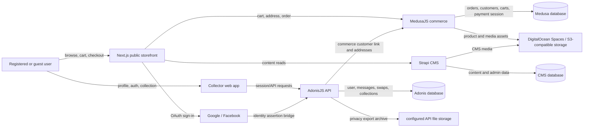

# Technical privacy audit: data flows

**As implemented in repository source; production routes and vendor settings remain unverified.** Not legal advice.

| Flow | Evidence / status | Risk and unknown |
|---|---|---|
| Registration, login, mobile OTP | Adonis auth routes/controllers and user schema: `apps/api/start/routes/v1/auth.routes.ts`, `apps/api/app/controllers/auth_controller.ts`, `apps/api/database/schema.ts`. OTP endpoints are currently wired to disabled handler. | Confirm live route build, OTP provider and whether code logging helper ships. |
| OAuth identity | Next Better Auth configured with Google/Facebook; assertion bridge into Adonis: `apps/public-web/src/lib/auth/better-auth.server.ts`, `apps/api/app/services/social_auth_assertion.ts`. | Provider-side collection and transfer depend on scopes/account configuration; confirm callback and claim retention. |
| Profile/community | Collector web → Adonis for profile, preferences, collections, reviews, messaging and swaps. Models/controllers/routes under `apps/api/app/` and `apps/api/start/routes/v1/`. | User-generated personal data may be copied into messages/trades; linked records and retention not fully mapped. |
| Guest/registered purchase | Browser → Next server actions → Medusa cart/order APIs; cart identifier is a cookie; checkout captures contact/address and links signed-in identity where available. `apps/public-web/src/lib/commerce/{cart-actions,checkout-actions}.ts`. | Medusa receives direct contact and delivery data. Confirm guest order lookup/security and actual shipping providers. |
| Payment | Medusa payment module configured for local offline provider; InstaPay instructions returned by custom store endpoint. `apps/backend/medusa-config.ts`, `apps/backend/src/modules/offline-payment/service.ts`, `apps/backend/src/api/store/payment-instructions/route.ts`. | InstaPay app/bank sees payment transaction details outside repo control. No payment gateway integration evidenced. Confirm manually handled proof/receipts and who accesses them. |
| CMS/media | Admin/content operators → Strapi → CMS database and Spaces-compatible object storage. `apps/cms/config/database.ts`, `apps/cms/config/plugins.ts`. Medusa separately uses S3 file provider. | Public URLs, geographic region, CDN/cache, metadata and deletion propagation are unknown. |
| Privacy export/deletion | Authenticated collector UI → Adonis export/deletion endpoints → queued export file, 7-day expiry; deletion anonymizes account and cancels exports. `apps/web/src/pages/AccountSettings.tsx`, `apps/api/app/controllers/identity_controller.ts`, `apps/api/app/jobs/`. | Export scope and deletion across Medusa/CMS/Spaces, backups, logs and vendors not proven. |
| Hosting/telemetry | Runtime providers cannot be proven from code; DigitalOcean-compatible storage is configured by environment. | Deployment manifests, actual regions, logging/monitoring vendors and subprocessors require operator confirmation. |
