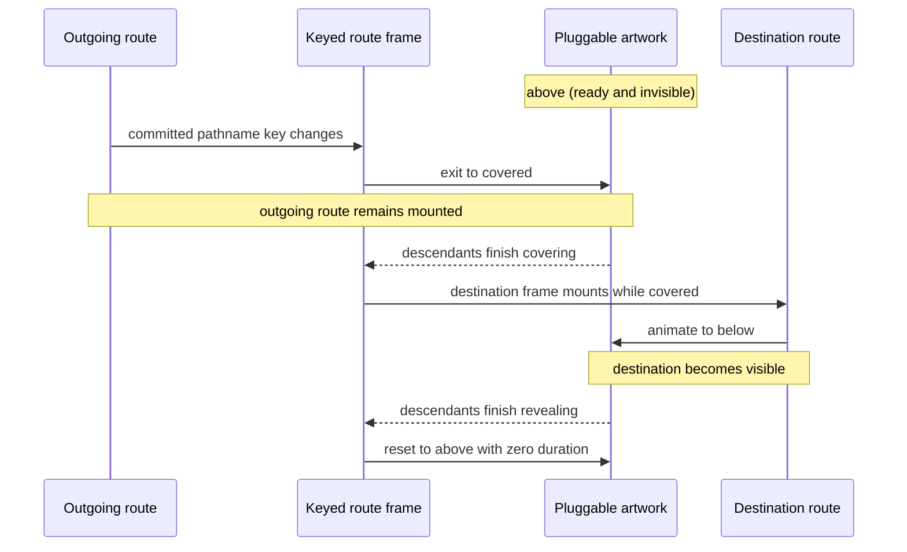

# Cover/reveal page-transition artwork contract

This directory owns the shared lifecycle for full-page transition artwork. The
controller is intentionally independent of a particular visual theme: a solid
curtain, rows, cards, illustrations, or another decorative composition can all
participate when they implement the same cover/handoff/reveal contract.

This is not a catalog of every possible navigation effect. Fade-only page
transitions and shared-element transitions have different lifecycle needs and
do not satisfy this contract unless they also provide the opaque handoff
described below.

## Architecture at a glance

The transition has two separate concerns:

- The **route controller** detects a committed pathname change, preserves the
  outgoing route, sequences exit before entry, and decides when the handoff is
  safe.
- The **artwork** decides how the curtain looks and how its groups and items
  move. It never decides when navigation occurred.

All compatible artwork uses these Motion variant labels:

```ts
import type { Variants } from "motion/react";

export type PageTransitionState = "above" | "covered" | "below";

export type PageTransitionVariants = Record<
  PageTransitionState,
  Variants[string]
>;
```

These labels are the interface between the controller and every descendant
Motion element. An artwork implementation may add internal variants on nested
elements, but it must not rename or omit the three page-transition states.

## Lifecycle

| Variant | Visible result | Responsibility |
| --- | --- | --- |
| `above` | No transition artwork is visible. The artwork is parked above the viewport. | Ready state before the next navigation and the instantaneous reset target after revealing a page. |
| `covered` | An opaque surface covers the complete viewport without gaps. | Safe route-handoff point: the outgoing page can be replaced without exposing partially committed content. |
| `below` | No transition artwork is visible. The artwork has left below the viewport. | Reveals the destination. Completion triggers an immediate reset to `above`. |

The React controller has only two phases. They are not additional Motion
variant names:

| Controller phase | Active Motion variant |
| --- | --- |
| `ready` | `above` |
| `revealing` | `below` |

Covering is owned by the outgoing keyed frame through `exit="covered"`. Do not
introduce controller phases such as `covering`, and do not infer a phase from
the number of renders.



## Responsibility by layer

### `PageAnimatePresence`

- Reads the committed pathname and keys one direct presence child with it.
- Uses `AnimatePresence mode="wait"` so the outgoing frame reaches `covered`
  before the destination frame enters.
- Owns the cold-load policy. Loading a route directly must not play a
  navigation curtain.
- Selects or receives an artwork implementation without embedding its visual
  rules into the controller.
- Treats repeated renders as normal React behavior, not as navigation events.

### `RouteTransitionFrame`

- Owns `initial`, `animate`, and `exit`.
- Maps `ready` to `above` and `revealing` to `below`.
- Uses `covered` as the entering handoff state and the exiting target.
- Provides a sequencing barrier with `when: "afterChildren"`, so frame
  completion means all descendant artwork has completed the same state.
- Changes from `revealing` to `ready` only after `below` completes.

### `FrozenRoute`

- Is the Next.js App Router adapter that preserves the outgoing route subtree
  while the keyed frame exits.
- Does not own visual variants, artwork selection, or timing.
- Remains an integration concern; artwork should not import or depend on it.

### Artwork root

- Is a fixed viewport overlay above all page content.
- Uses `pointer-events-none`, `aria-hidden="true"`, and empty image
  alternatives because it is decorative.
- Clips moving content so hidden states cannot leak into the viewport.
- Supplies an opaque token-backed fallback surface. Images are decoration and
  must not be required for coverage.
- Implements all three lifecycle variants itself or allows them to propagate
  to descendants that do.

A typical root starts with the following structural classes. The selected
background token must resolve to an opaque color:

```tsx
<div
  aria-hidden="true"
  className="pointer-events-none fixed inset-0 z-60 h-dvh w-screen overflow-hidden bg-background"
>
  {artwork}
</div>
```

### Optional group or row

- Owns coverage geometry, stacking order, and sibling orchestration.
- Owns `delayChildren` and `staggerChildren`; an item cannot stagger its
  siblings.
- Ensures that all groups together fill the complete viewport in `covered`.
- Uses stable content or group identifiers as keys.

### Individual decorative item

- Owns only its local transform, opacity, rotation, or scale.
- Never controls the route phase or route handoff.
- Uses a stable content identifier as its React key, not its array index.
- May fail to load without leaving a transparent hole in the curtain.

## Motion-token prerequisite

All durations, easings, distances, and stagger intervals must come from one
shared motion foundation. Examples below use semantic references such as
`motionTokens.duration.slow`, `motionTokens.easing.smooth`, and
`motionTokens.stagger.item`.

There is currently **no shared motion-token module or export in
`packages/ui-web`**. The snippets intentionally do not invent an import path.
They describe the contract to use after that shared foundation is created. Do
not import tokens from a particular artwork component: the current local token
objects are implementation details and are duplicated.

The eventual foundation must provide, at minimum:

- a zero-animation policy for resets and reduced motion;
- semantic page-transition durations and easing;
- a group/item stagger token between `0.05s` and `0.10s`;
- transform distances or geometry tokens when pixel distances are used.

Literal `0` in the examples means “do not animate”; it is a lifecycle command,
not a design timing value.

## Reference route controller

The route frame itself does not need a visual transform. Its variants provide
the shared labels and wait for descendants:

```tsx
"use client";

import { AnimatePresence, motion, type Variants } from "motion/react";
import { usePathname } from "next/navigation";
import { useEffect, useState, type ReactNode } from "react";
import { FrozenRoute } from "../frozen-route";

type PageTransitionState = "above" | "covered" | "below";
type PageTransitionVariants = Record<
  PageTransitionState,
  Variants[string]
>;

const frameVariants = {
  above: {
    transition: { duration: 0, when: "afterChildren" },
  },
  covered: {
    transition: { when: "afterChildren" },
  },
  below: {
    transition: { when: "afterChildren" },
  },
} satisfies PageTransitionVariants;

type ControllerPhase = "ready" | "revealing";

function RouteTransitionFrame({
  children,
  startsReady,
}: {
  children: ReactNode;
  startsReady: boolean;
}) {
  const [phase, setPhase] = useState<ControllerPhase>(() =>
    startsReady ? "ready" : "revealing",
  );
  const activeVariant: PageTransitionState =
    phase === "ready" ? "above" : "below";

  return (
    <motion.div
      variants={frameVariants}
      initial={startsReady ? false : "covered"}
      animate={activeVariant}
      exit="covered"
      onAnimationComplete={(definition) => {
        if (phase === "revealing" && definition === "below") {
          setPhase("ready");
        }
      }}
    >
      {children}
    </motion.div>
  );
}

function PageAnimatePresence({
  children,
  artwork,
}: {
  children: ReactNode;
  artwork: ReactNode;
}) {
  const pathname = usePathname();
  const [hasCommitted, setHasCommitted] = useState(false);

  useEffect(() => {
    setHasCommitted(true);
  }, []);

  return (
    <AnimatePresence mode="wait" initial={false}>
      <RouteTransitionFrame key={pathname} startsReady={!hasCommitted}>
        <FrozenRoute>{children}</FrozenRoute>
        {artwork}
      </RouteTransitionFrame>
    </AnimatePresence>
  );
}
```

The `artwork` slot illustrates the target separation of concerns; it is not a
claim that the current exported component already has this prop. The example
uses committed state for the initial-load policy rather than reading or
negating a ref during render. `RouteTransitionFrame` freezes the starting value
in its state, so the post-commit parent render cannot restart the initial frame.
`AnimatePresence initial={false}` independently prevents initial presence
animations.

The phase and definition checks protect the frame from stale or unrelated
completion notifications. `when: "afterChildren"` makes completion a barrier
for the selected artwork rather than only the empty frame.

## Artwork recipes

Each recipe below is an interchangeable visual implementation of the same
three states. It is not a new route lifecycle.

### Minimal solid curtain

Use this as the baseline and fallback. It does not depend on images, so it can
always reach `covered` and complete `below`.

```tsx
"use client";

import { motion, useReducedMotion } from "motion/react";

type ArtworkCustom = {
  reducedMotion: boolean;
};

const solidCurtainVariants = {
  above: {
    y: "-100%",
    transition: { duration: 0 },
  },
  covered: ({ reducedMotion }: ArtworkCustom) => ({
    y: "0%",
    transition: {
      duration: reducedMotion ? 0 : motionTokens.duration.slow,
      ease: motionTokens.easing.smooth,
    },
  }),
  below: ({ reducedMotion }: ArtworkCustom) => ({
    y: "100%",
    transition: {
      duration: reducedMotion ? 0 : motionTokens.duration.slow,
      ease: motionTokens.easing.smooth,
    },
  }),
} satisfies PageTransitionVariants;

function SolidCurtain() {
  const reducedMotion = Boolean(useReducedMotion());

  return (
    <motion.div
      aria-hidden="true"
      className="pointer-events-none fixed inset-0 z-60 h-dvh w-screen bg-background"
      custom={{ reducedMotion }}
      variants={solidCurtainVariants}
    />
  );
}
```

The `reducedMotion` property is intentionally named the same way in the custom
object and every variant callback.

### Grouped or row-based curtain

Groups own their viewport segment and orchestration. Their geometry may vary,
but the union of every group must be opaque at `covered`.

```tsx
type GroupCustom = ArtworkCustom & {
  groupIndex: number;
  groupCount: number;
};

const groupVariants = {
  above: {
    y: "-100%",
    transition: { duration: 0, delayChildren: 0, staggerChildren: 0 },
  },
  covered: ({ groupIndex, reducedMotion }: GroupCustom) => {
    const delay = reducedMotion
      ? 0
      : groupIndex * motionTokens.stagger.group;

    return {
      y: `${groupIndex * 100}%`,
      transition: {
        duration: reducedMotion ? 0 : motionTokens.duration.slow,
        delay,
        delayChildren: delay,
        staggerChildren: reducedMotion ? 0 : motionTokens.stagger.item,
        staggerDirection: 1,
        ease: motionTokens.easing.smooth,
      },
    };
  },
  below: ({ groupIndex, groupCount, reducedMotion }: GroupCustom) => {
    const delay = reducedMotion
      ? 0
      : groupIndex * motionTokens.stagger.group;

    return {
      y: `${groupCount * 100}%`,
      transition: {
        duration: reducedMotion ? 0 : motionTokens.duration.slow,
        delay,
        delayChildren: delay,
        staggerChildren: reducedMotion ? 0 : motionTokens.stagger.item,
        staggerDirection: 1,
        ease: motionTokens.easing.smooth,
      },
    };
  },
} satisfies PageTransitionVariants;
```

Forward `staggerDirection: 1` on both `covered` and `below` makes items enter
and leave in the same order. Reverse it only when the visual design explicitly
requires the opposite order.

### Staggered item artwork

Items implement local motion and inherit sequencing from their group:

```tsx
const itemVariants = {
  above: ({ reducedMotion }: ArtworkCustom) => ({
    y: reducedMotion ? "0%" : "-100%",
    transition: { duration: 0 },
  }),
  covered: ({ reducedMotion }: ArtworkCustom) => ({
    y: "0%",
    opacity: 1,
    transition: {
      duration: reducedMotion ? 0 : motionTokens.duration.normal,
      ease: motionTokens.easing.smooth,
    },
  }),
  below: ({ reducedMotion }: ArtworkCustom) => ({
    y: reducedMotion ? "0%" : "100%",
    opacity: 1,
    transition: {
      duration: reducedMotion ? 0 : motionTokens.duration.normal,
      ease: motionTokens.easing.smooth,
    },
  }),
} satisfies PageTransitionVariants;
```

The parent still supplies an opaque background. An item may be late, broken,
or absent without changing the route lifecycle.

### Rotation or scale artwork

Custom local effects are valid when the group still provides full coverage.
Rotation or scale must never expose the page at `covered`:

```tsx
type DimensionalCustom = ArtworkCustom & {
  hiddenRotation: number;
  hiddenScale: number;
};

const dimensionalItemVariants = {
  above: ({
    hiddenRotation,
    hiddenScale,
    reducedMotion,
  }: DimensionalCustom) => ({
    rotateY: reducedMotion ? 0 : -hiddenRotation,
    scale: reducedMotion ? 1 : hiddenScale,
    transition: { duration: 0 },
  }),
  covered: ({ reducedMotion }: DimensionalCustom) => ({
    rotateY: 0,
    scale: 1,
    transition: {
      duration: reducedMotion ? 0 : motionTokens.duration.normal,
      ease: motionTokens.easing.smooth,
    },
  }),
  below: ({
    hiddenRotation,
    hiddenScale,
    reducedMotion,
  }: DimensionalCustom) => ({
    rotateY: reducedMotion ? 0 : hiddenRotation,
    scale: reducedMotion ? 1 : hiddenScale,
    transition: {
      duration: reducedMotion ? 0 : motionTokens.duration.normal,
      ease: motionTokens.easing.smooth,
    },
  }),
} satisfies PageTransitionVariants;
```

Pass `hiddenRotation` and `hiddenScale` from the eventual shared foundation.
They are custom data here so the example does not invent token names or replace
them with raw transform values inside the artwork component.

## Reduced motion

Reduced motion keeps the route-handoff semantics but removes animated spatial
movement:

- `above`, `covered`, and `below` still describe the same visibility and
  coverage states.
- Positional changes snap with zero duration instead of travelling across the
  viewport.
- Group and item stagger delays become zero.
- Rotation and scale resolve to their neutral values.
- An optional opacity fallback must use a shared token no longer than `0.2s`.
- The completion barrier still runs, even when every descendant completes
  immediately.

Do not remove the curtain without another atomic way to protect the route
handoff. Reduced motion changes movement, not correctness.

## React, Next.js, and accessibility rules

1. Files importing `motion/react`, `usePathname`, or client hooks begin with
   `"use client"`.
2. Render stays pure: no logging, mutations, navigation side effects, or ref
   reads/writes in the render body.
3. Render count is never a navigation signal. Strict Mode and ordinary state
   updates can render the same pathname repeatedly.
4. One direct child under `AnimatePresence` owns the pathname key, variants,
   and `exit` target.
5. Use `mode="wait"`; overlapping route frames would break the protected
   handoff.
6. A cold load does not animate the curtain. Initial state must be compatible
   with server output and hydration.
7. Large artwork subtrees use explicit transforms rather than `layout`.
8. Artwork is decorative and cannot capture pointer or keyboard interaction.
9. Focus management and scroll restoration remain route concerns; the curtain
   must not steal focus or reset scroll itself.
10. Loading or failed artwork cannot prevent `covered` or `below` from
    completing.

## Authoring checklist

Before accepting a new artwork implementation, verify:

- It implements exactly `above`, `covered`, and `below` at every participating
  Motion layer.
- `above` and `below` leave no artwork visible.
- `covered` is opaque across the complete viewport at every supported size.
- The root remains opaque when every image fails to load.
- `below` completion resets to `above` without animation.
- Parent groups own sibling delay and stagger.
- Item and group keys are stable across renders.
- Custom data consistently uses `reducedMotion`.
- Reduced motion has no animated transforms or stagger.
- The route frame waits for all descendants before reporting completion.
- Cold load, forward navigation, back navigation, repeated navigation, and
  rapid navigation cannot strand the curtain.
- Strict Mode does not create an extra transition from repeated renders.

## Current repository status — not normative

The following findings describe the current worktree. They are implementation
discrepancies to resolve separately and must not be copied into new artwork:

- `PageAnimatePresence` passes `routeVariants`, which defines `idle` and
  `routeExit`, while the frame requests `above`, `covered`, and `below`.
- `routeNewVariants` defines the contract labels but is currently unused.
- `skipInitialReveal={!hasMounted}` negates the ref object, so it is always
  `false`. Reading `hasMounted.current` during render would also violate the
  selected ref discipline; the cold-load policy needs explicit lifecycle
  state.
- The render-body `console.log` records render attempts, not committed
  navigation, mounting, or pathname changes.
- The cards and TCG artwork do not currently implement equivalent coverage
  geometry.
- TCG passes `reduceMotion`, while its variant callbacks read
  `reducedMotion`.
- The TCG component imports Motion and React hooks without a `"use client"`
  directive.
- Cards and TCG each define a local `motionTokens` object. No shared motion
  foundation currently exists in `packages/ui-web`.
- The cards row stagger is currently `0.12s`, outside the documented
  `0.05s`–`0.10s` range.

`Cards` and `TCG` are therefore current artwork implementations, not reference
architectures. This appendix should remain until the controller, token
foundation, and artwork implementations are deliberately aligned.
